# OntaPulse

Monitor your websites and APIs, and see their security posture, in one shared workspace.

OntaPulse runs passive checks against your targets in the background and shows what it observed: is the site up, are the security headers and certificate healthy, did a DNS record change, and which CDN or WAF sits in front.

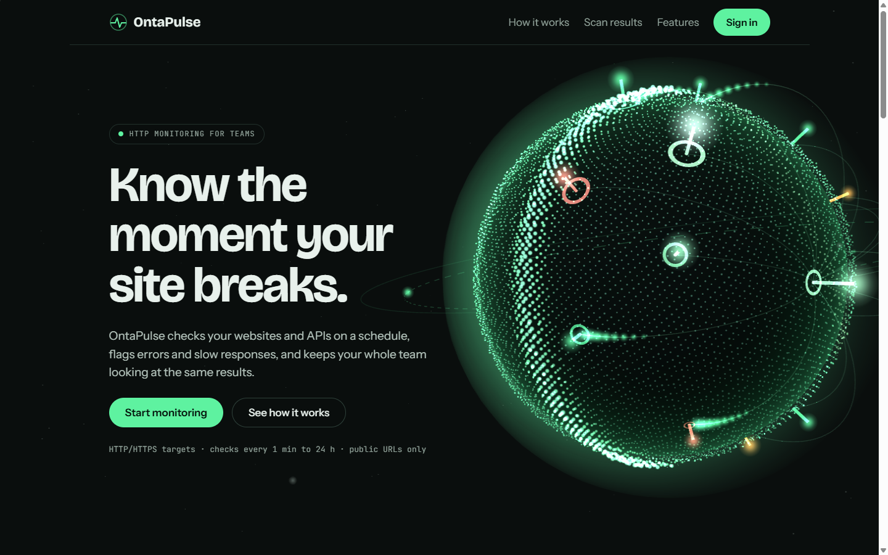

## What it checks

| Check                | What you get                                                                                     |
| -------------------- | ------------------------------------------------------------------------------------------------ |
| **Availability**     | HTTP status and response time, with findings for 4xx, 5xx, and slow responses                    |
| **Security posture** | Security headers, cookie flags, CORS, HTTP to HTTPS redirect, TLS and certificate, exposed files |
| **Domain and DNS**   | Record changes against a baseline, dangling CNAME, SPF, DKIM, DMARC                              |
| **Edge profile**     | The CDN, WAF, and anti-bot layer in front of a site (informational)                              |

Everything is passive: read-only requests, one TLS handshake, and DNS queries. OntaPulse never attacks, fuzzes, or bypasses a WAF. Exposed-file probes stay off until an owner or admin enables them and confirms they are allowed to test the target.

## Screenshots

**Security findings** on a monitor, worded as "observed" with a suggested fix:

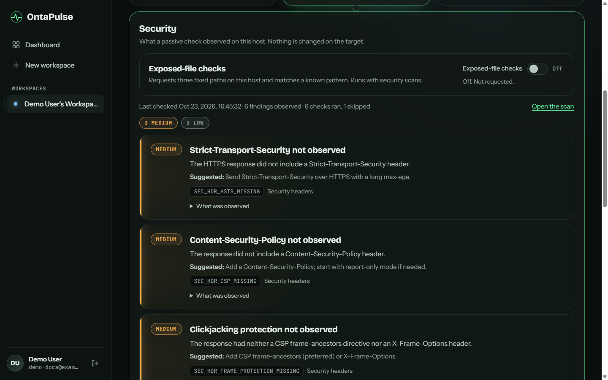

**Domain and DNS** with email authentication results:

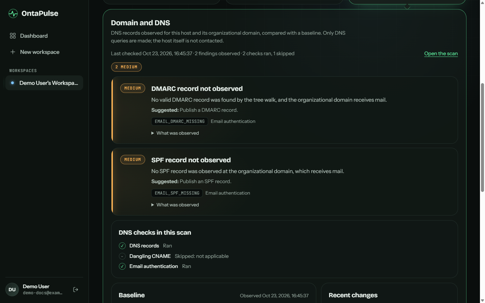

**Edge profile**, here a detected CDN:

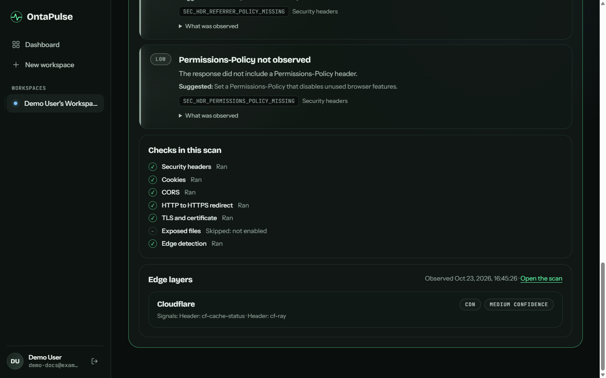

|                  Dashboard                   |                                 Monitor and its checks                                 |
| :------------------------------------------: | :------------------------------------------------------------------------------------: |
| 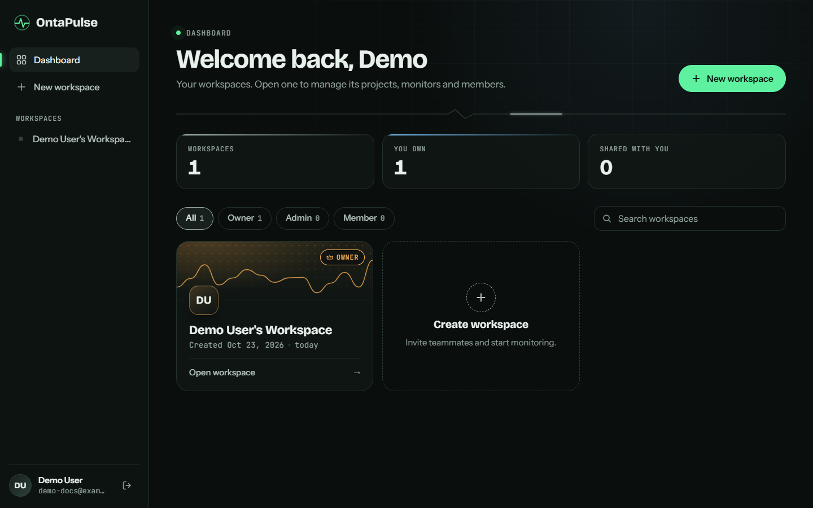 | 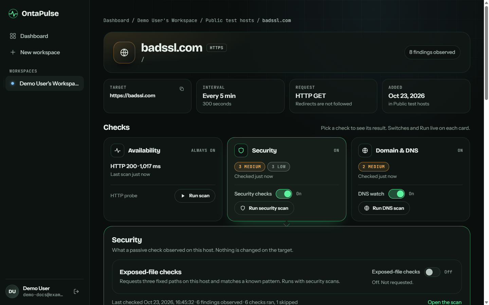 |
|                **Workspace**                 |                                    **Scan detail**                                     |
| 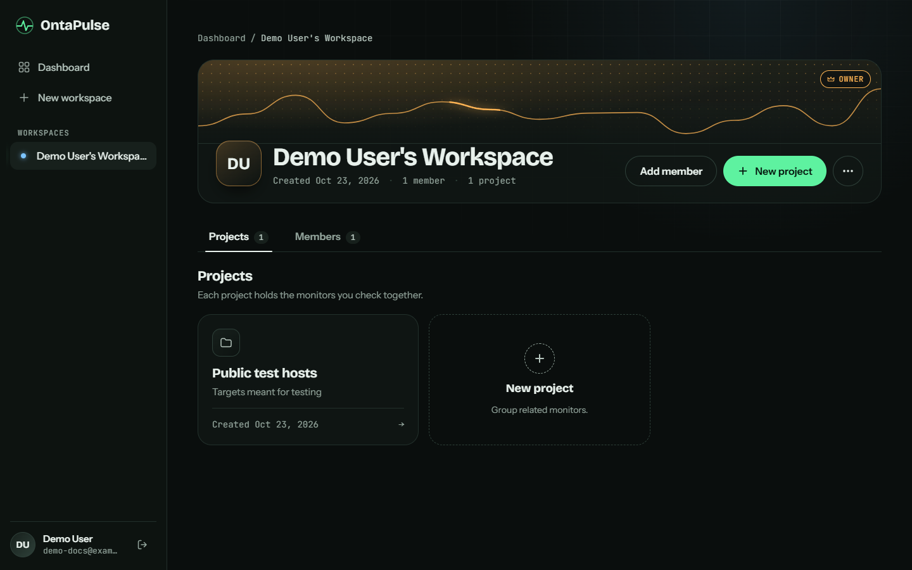 |                    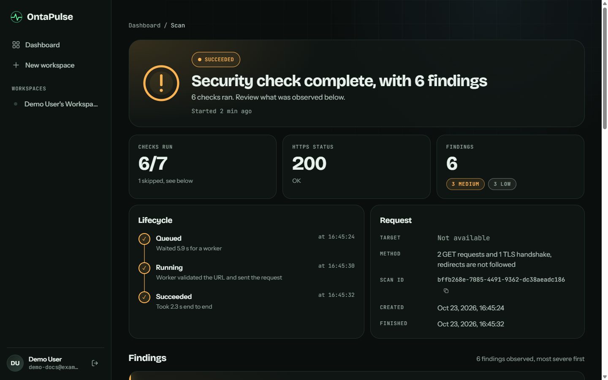                    |

|                 Project                  |                Sign in                |                Mobile (360 px)                 |
| :--------------------------------------: | :-----------------------------------: | :--------------------------------------------: |
| 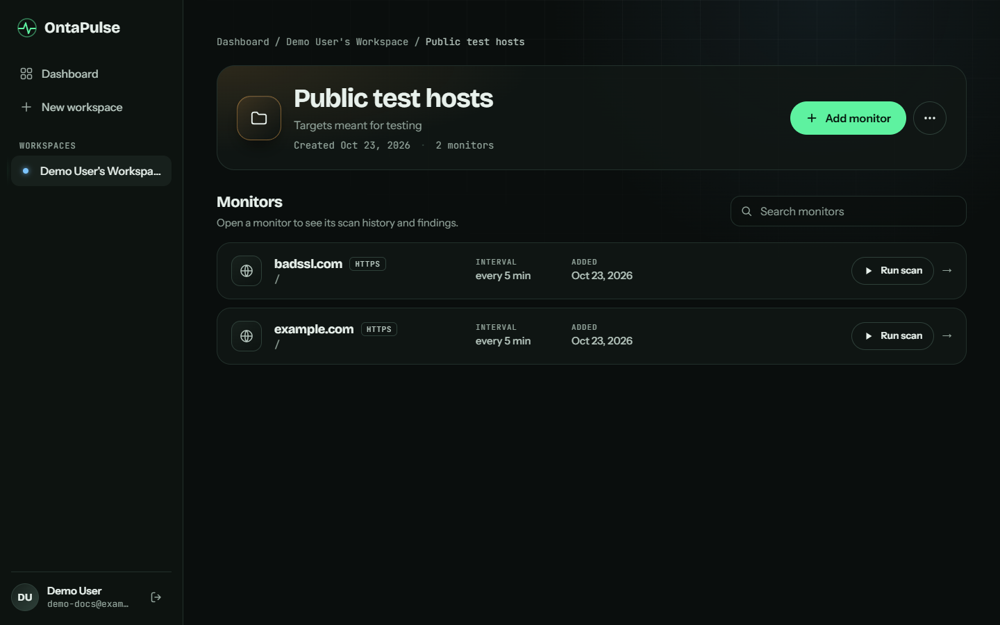 | 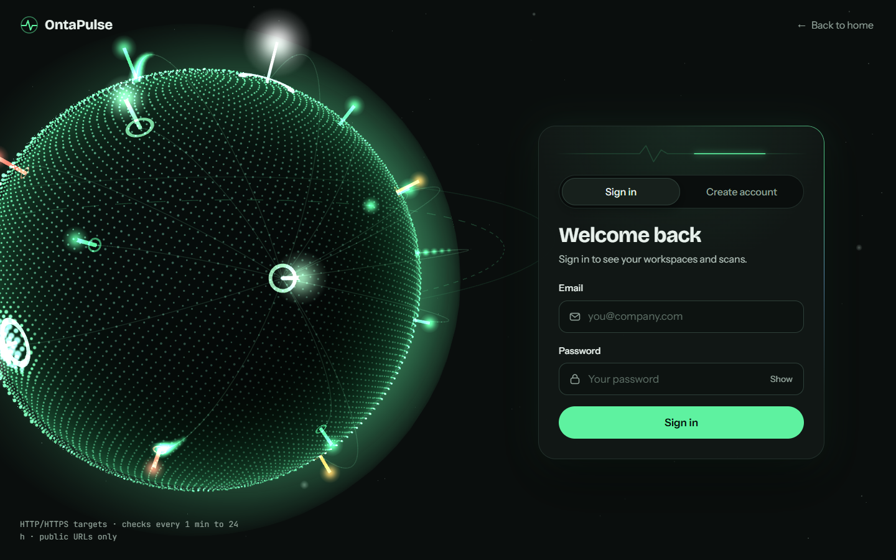 | 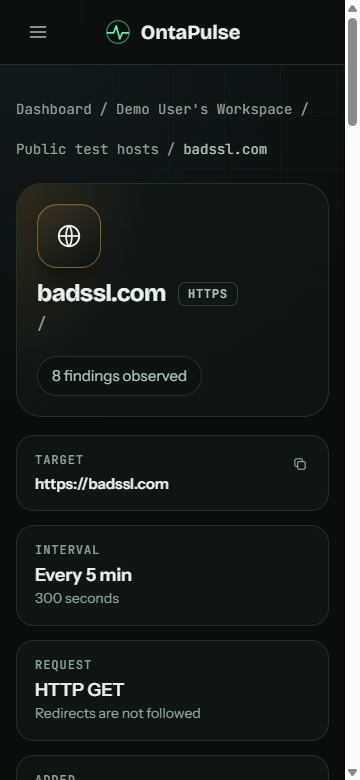 |

Taken from a local run against public test hosts (`example.com` and `badssl.com`).

## Features

- Workspaces with `OWNER`, `ADMIN`, and `MEMBER` roles; projects and monitors inside them.
- Manual scans and recurring scans: availability at the monitor interval, security every 24 h, DNS every 6 h.
- Findings with stable catalog IDs, severity, and confidence. Conditions caused by the target are findings, not scan failures.
- A job queue (RabbitMQ) with retries, a dead-letter queue, and safe duplicate handling.
- SSRF protection on every connection: the worker only connects to validated public addresses and never follows redirects.
- Sessions in `httpOnly` cookies, Argon2id password hashing, and `404` for anything outside your workspaces.

## How it works

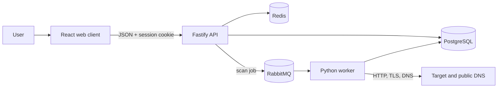

The API stores a `QUEUED` scan and publishes a job. The worker runs the check for the scan's kind (`HTTP_PROBE`, `SECURITY_POSTURE`, or `DNS_WATCH`) and stores the status, findings, and observations. The web client only displays stored results. See [docs/architecture.md](docs/architecture.md).

| Part   | Stack                                                                           |
| ------ | ------------------------------------------------------------------------------- |
| Web    | React 19, React Router 7, Vite 8, TypeScript, Tailwind CSS 4, Radix UI          |
| API    | Fastify 5, TypeScript, Prisma 7, Zod, Redis, RabbitMQ (amqplib)                 |
| Worker | Python 3.13, HTTPX, dnspython, Pika, SQLAlchemy 2, Psycopg 3                    |
| Infra  | PostgreSQL 17, Redis 7, RabbitMQ 4 (Docker Compose); pnpm 11, Node 24, Moon, uv |

```text
apps/api      Fastify API, Prisma schema and migrations
apps/web      React/Vite client
apps/worker   Python scan worker
docs/         Architecture, development, queue contract, security checks, API reference
```

## Quick start

You need Git, Docker, Node.js `24.14.0`, pnpm `11.22.0`, Python `3.13`, [uv](https://docs.astral.sh/uv/), and [Moon](https://moonrepo.dev/proto). Versions are in `.prototools`.

```bash
git clone <repository-url>
cd OntaPulse
cp .env.example .env          # PowerShell: Copy-Item .env.example .env
```

Replace every password placeholder in `.env` and keep `localhost` in the connection URLs. Then:

```bash
pnpm install
moon run worker:sync
docker compose up -d && docker compose ps      # wait until healthy
pnpm --filter @ontapulse/api exec prisma migrate dev
pnpm --filter @ontapulse/api db:seed           # optional demo data
```

Start the three apps in separate terminals:

```bash
moon run api:dev
moon run worker:dev
moon run web:dev
```

| Service             | URL                                                      |
| ------------------- | -------------------------------------------------------- |
| Web                 | [http://localhost:5173](http://localhost:5173)           |
| Swagger UI          | [http://localhost:3000/docs](http://localhost:3000/docs) |
| RabbitMQ Management | [http://localhost:15672](http://localhost:15672)         |

Register on the landing page, create a project and a monitor with a public URL, and run a scan. The worker rejects private and loopback addresses by design.

## Checks before merging

```bash
moon run api:typecheck && moon run api:test
moon run web:typecheck && moon run web:test && moon run web:build
moon run worker:lint && moon run worker:format-check && moon run worker:test
pnpm format:check && git diff --check
```

## Documentation

| Document                                                      | Contents                                                                   |
| ------------------------------------------------------------- | -------------------------------------------------------------------------- |
| [Architecture](docs/architecture.md)                          | Components, data flow, scan flow, scheduling, module boundaries            |
| [Development](docs/development.md)                            | Setup, environment variables, commands, migrations, tests, troubleshooting |
| [API reference](docs/api.md)                                  | Roles, routes, and the error contract (Swagger UI has the schemas)         |
| [Security checks](docs/security-checks.md)                    | Check catalog, finding IDs, severities, budgets, path allowlist            |
| [Queue contract](docs/queue-contract.md)                      | RabbitMQ topology, retries, delivery rules, dead-letter redrive            |
| [Display content mapping](docs/display-content-mapping.md)    | What each screen shows (Bahasa Indonesia)                                  |
| [Web](apps/web/README.md) and [worker](apps/worker/README.md) | Structure of each app                                                      |

## Current limitations

- No notifications or alerting yet.
- Monitor edit, delete, pause, and resume exist in the API but not in the web client. The queue-health and redrive endpoints have no screen either.
- No uptime, SLA, or incident aggregates.
- DKIM selector discovery is best effort, and edge detection covers only the vendors listed in the catalog.
- Targets on private networks are rejected on purpose. Do not weaken the SSRF validation to reach internal hosts.

## License

[MIT](LICENSE). Copyright (c) 2026 Muhammad Dzaki Arta.

Created and maintained by **TuanOnta / Muhammad Dzaki Arta**.
