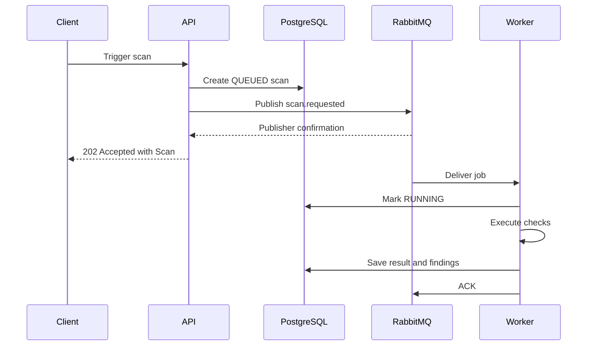

# Architecture

## System components

| Component  | Responsibility                                                                     |
| ---------- | ---------------------------------------------------------------------------------- |
| Web        | User interface for projects, monitors, scans, and findings                         |
| API        | HTTP contract, validation, business orchestration, persistence, and job publishing |
| PostgreSQL | Source of truth for projects, monitors, scans, and findings                        |
| RabbitMQ   | Durable delivery of scan jobs from the API to workers                              |
| Worker     | Fetches targets, performs checks, and persists scan results                        |
| Redis      | Cache, rate limiting, locks, and temporary state; not the primary scan queue       |

## Implementation status

The TypeScript API implements Project, Monitor, and Scan persistence together
with confirmed RabbitMQ publication. Its in-process scheduler periodically
claims due active monitors and queues scans using the stored interval.

The Python worker is active and implements:

- strict scan message validation;
- idempotent Scan claiming;
- HTTP GET execution with explicit timeouts;
- URL and SSRF safety checks;
- response-time measurement;
- finding generation and persistence;
- bounded delayed retries;
- dead-letter routing;
- connection recovery;
- graceful shutdown with active-job draining;
- structured logging;
- unit and RabbitMQ integration tests.

Session-based authentication and workspace authorization are implemented. The web client implements auth, workspaces, projects, monitors, and scans.

### Planned: security features

Three capability areas are designed in [security-checks.md](security-checks.md) and are built in phases on top of
the existing monitors. None of them is implemented yet.

- Web security posture (`SECURITY_POSTURE`): headers, cookies, CORS, HTTP to HTTPS redirect, TLS and certificate,
  opt-in exposed-file probes.
- Domain and DNS watch (`DNS_WATCH`): record changes against a baseline, dangling CNAME, SPF, DKIM, DMARC.
- Edge detection: WAF, CDN, and anti-bot vendor profile, derived from data the two scan kinds already collect.

All checks are passive. The existing `HTTP_PROBE` behavior and contract do not change.

## Domain model

```text
Project
└── Monitor
    └── Scan
        └── ScanFinding
```

- A Project groups related monitors.
- A Monitor defines one HTTP or HTTPS target and its interval.
- A Scan represents one execution for a monitor.
- A ScanFinding records an issue discovered during a scan.

Refer to `apps/api/prisma/schema.prisma` for exact fields, enums, relations, indexes, and deletion behavior.

### Planned additions (additive)

| Concept                    | Purpose                                                                                 |
| -------------------------- | --------------------------------------------------------------------------------------- |
| Scan kind                  | `HTTP_PROBE` (default), `SECURITY_POSTURE`, `DNS_WATCH`, stored on the Scan row         |
| Finding fields             | Stable `checkId`, category, optional confidence, bounded sanitized evidence             |
| Observation (edge profile) | Non-finding result: detected WAF, CDN, anti-bot vendors, confidence, supporting signals |
| DNS baseline               | Latest normalized record snapshot per monitored host plus a bounded change history      |
| Monitor check settings     | Enabled scan kinds; path-probe opt-in with acknowledging user and time                  |

Existing rows keep working: new columns are nullable or defaulted, and enums are extended, never renamed.
Names are final only once they appear in `schema.prisma`.

Phase 2 makes `SECURITY_POSTURE` runnable (headers, cookies, CORS, and the HTTP to HTTPS redirect); Phase 3 adds the
TLS and certificate check (one verified handshake); Phase 4 adds edge detection (a pure evaluator over the data
the posture scan already holds, stored as one `MonitorEdgeProfile` per monitor). Phase 5 adds opt-in path probes (three fixed GETs, a bounded body match; enabling needs an acknowledgment).
Phase 6 makes DNS watch runnable: a `DnsResolver` port over `dnspython` and public resolvers, a per-monitor
baseline (`DnsBaseline`) with a bounded change history (`DnsChange`), dangling CNAME, SPF, DMARC, and best-effort DKIM. Recurring runs are a later phase.

Implemented so far (scan kind plumbing): `Scan.kind`, `ScanFinding.checkId`, `category`, and `confidence`, and the
`MonitorCheckSettings` table. Only `HTTP_PROBE` is runnable; the worker dispatches by kind through a registry and
the API rejects other kinds on trigger until their checks ship. The edge profile and DNS baseline tables are added
in the phases that use them.

## Scan flow



The API returns `202` only after the confirm channel acknowledges a manual publication. The scheduler uses the same queue lifecycle without an HTTP response. If publication fails, the API changes the Scan to `FAILED`, sets `finishedAt` and a safe error message.

The scheduler runs every 10 seconds. A due monitor is atomically claimed by moving
its `nextScheduledAt` forward before the Scan is created, so concurrent API
instances do not queue the same scheduled occurrence twice. Each next execution
is calculated from the claim time plus `intervalSeconds`; missed intervals do not
produce a catch-up burst.

The scheduler creates its Scan and pending outbox event in the same transaction.
The monitor keeps its advanced `nextScheduledAt`, so retrying a scheduler cycle
cannot duplicate the same scheduled occurrence; a temporary broker outage leaves
the outbox event pending instead of failing the Scan. Each non-empty scheduler cycle
emits the structured `Scan scheduler run completed` event with `dueMonitorCount`,
`scheduledCount`, and `durationMs` for log-derived metrics.

The scheduler and the manual trigger create a Scan with its kind (default `HTTP_PROBE`). Security and DNS scan
kinds use their own limits from the catalog, not the 60 second `HTTP_PROBE` floor: a short cooldown for manual runs and an hourly
minimum for scheduled runs.

Each cycle has two passes. The availability pass is the one described above and is unchanged. The check pass then
creates recurring `SECURITY_POSTURE` and `DNS_WATCH` scans for monitors that enabled them. The monitor's
`intervalSeconds` does not apply to these kinds: each has a fixed interval from the catalog (24 h for security, 6 h for
DNS) and its own next-run column on `MonitorCheckSettings` (`securityNextScheduledAt`, `dnsNextScheduledAt`). Switching a
check on starts its schedule one interval later (only if it has none); switching it off clears it. A check pass claims a
due check the same way as the availability pass, by moving the next-run time forward in the same transaction that creates
the Scan and its outbox event, under the same per-workspace advisory lock as manual triggers. The occurrence is skipped,
and the schedule still advances, when the workspace is at its hourly limit for that kind or a scan of that kind is still
`QUEUED` or `RUNNING` for the monitor, so a full workspace or a stopped worker never builds a backlog. A deactivated
monitor is not scheduled. The manual cooldown does not apply to scheduled runs, and a manual run does not move the
schedule. The pass logs `Check scan scheduler run completed` with per-kind counts (`dueCount`, `scheduledCount`,
`skippedCount` by reason, `failedCount`); it never logs hostnames or anything read from a target. The worker needs no
change: it reads the kind from the Scan row and stays idempotent on `scanId`.

RabbitMQ delivery is at-least-once. The worker must therefore treat `scanId` as an idempotency key and avoid processing a completed scan twice.

The database transaction stores the Scan and outbox event atomically. A publisher leases pending events and marks each event published only after RabbitMQ confirmation. An interrupted or ambiguous publication can still duplicate a broker delivery after the lease expires, so the worker continues to use `scanId` for idempotency.

### Failure flow

Transient infrastructure errors are retried through dedicated delay queues:

```text
scan.jobs
→ scan.jobs.retry.5s
→ scan.jobs
→ scan.jobs.retry.30s
→ scan.jobs
→ scan.jobs.retry.120s
→ scan.jobs
→ scan.jobs.dead
```

The database remains the source of truth for scan state. RabbitMQ provides
durable delivery but does not replace database idempotency.

A target transport failure, such as a timeout or DNS error, is persisted as a
terminal Scan failure. An HTTP response, including a 4xx or 5xx response, completes
the Scan successfully and may produce a finding. RabbitMQ retry is reserved for
infrastructure failures that prevent the worker from safely finishing the database
lifecycle.

## API module boundaries

```text
route      Registers URL, HTTP method, and OpenAPI schema
controller Parses request data and produces the HTTP response
service    Enforces business rules and coordinates dependencies
repository Performs Prisma queries
```

Infrastructure implementations are accessed through interfaces where tests need substitutes. For example, `ScanService` depends on `ScanQueue`, while production uses `RabbitMqScanQueue` and tests use a fake queue.

Authenticated API resources are isolated by workspace membership. `OWNER` and `ADMIN` roles may create projects and monitors and trigger scans, while every workspace member may read projects, monitors, and scans. Requests for resources outside the user's workspaces return `404` to avoid exposing resource existence.

`server.ts` is the composition root. Development and production construct `RabbitMqScanQueue`; test mode uses `NoopScanQueue`, while scan integration tests inject a recording fake. The RabbitMQ connection is opened lazily and is closed together with Prisma during Fastify shutdown.

## Worker module boundaries

Worker features live under `ontapulse_worker/modules/<feature>`. The scan module owns
its domain models and errors, application ports and lifecycle service, and
RabbitMQ, HTTP, and SQLAlchemy adapters. Adapters depend on application/domain;
the domain does not import HTTPX, Pika, or SQLAlchemy.

`platform` provides shared settings, connection factories, and logging without scan
business rules. `bootstrap/container.py` composes the scan dependencies and owns their
resources. `entrypoints` controls process startup, shutdown, and database readiness.
Tests mirror these boundaries; current adapter tests use mocks, not live infrastructure.

```text
modules/scans/domain
  Scan jobs, results, findings, policies, and errors

modules/scans/application
  Lifecycle orchestration and dependency ports

modules/scans/adapters/rabbitmq
  RabbitMQ contract, topology, retry, and consumer

modules/scans/adapters/http
  HTTP execution and URL security

modules/scans/adapters/sqlalchemy_scan_repository.py
  SQLAlchemy Scan and finding persistence

platform
  Configuration, database setup, logging, and resilience

bootstrap
  Dependency construction and resource ownership

entrypoints
  Long-running worker and operational commands
```

Domain and application code do not import Pika, HTTPX, SQLAlchemy, or process
configuration. Concrete dependencies are assembled in the bootstrap layer.

### Planned: check families and dispatch

The lifecycle module dispatches by scan kind through a registry built in `bootstrap`. Each check family keeps the
same domain, application, adapters split:

```text
modules/http_probe         existing check (behavior unchanged)
modules/security_posture   headers, cookies, CORS, redirect, TLS, path probes
modules/dns_watch          baseline, diff, dangling CNAME, SPF, DKIM, DMARC
modules/edge_detection     WAF, CDN, anti-bot evaluator (pure, no I/O of its own)
```

New external dependencies get a port first (`HttpClient`, `TlsInspector`, `DnsResolver`); tests use fakes. Pure
evaluators take plain data and an injected clock. A check family never touches the broker or claims scans.
The worker never imports API code and never runs Prisma; schema changes originate in the API migration.

### Planned: security data flow

```text
web -> API (auth, role check, create Scan with kind + outbox in one tx) -> RabbitMQ
    -> worker (claim scan, read kind from the row, run check, persist) -> PostgreSQL
web <- API (reads scans, findings, observations, DNS baseline, edge profile)
```

The UI displays stored data only. The API decides authorization by workspace role: `OWNER` and `ADMIN` enable
checks, enable path probes (with an acknowledgment), and trigger security and DNS scans; every member reads results.

## Validation and errors

Fastify JSON Schema rejects malformed HTTP input before the controller. Zod performs application-level parsing and transformations such as trimming. Both schemas must describe the same accepted input.

Error responses use one contract:

```json
{
  "statusCode": 400,
  "code": "VALIDATION_ERROR",
  "message": "Request validation failed",
  "details": {},
  "requestId": "req-1"
}
```

`details` is optional. Unexpected errors must return a generic message while the technical error is retained in structured server logs.

## Sources of truth

| Information                       | Source                                       |
| --------------------------------- | -------------------------------------------- |
| HTTP request and response schemas | Fastify/OpenAPI route schemas and Swagger UI |
| Application input transformations | Zod schemas                                  |
| Database model                    | `apps/api/prisma/schema.prisma`              |
| Queue payload and delivery rules  | `docs/queue-contract.md`                     |
| Tool commands and local workflow  | `docs/development.md`                        |
